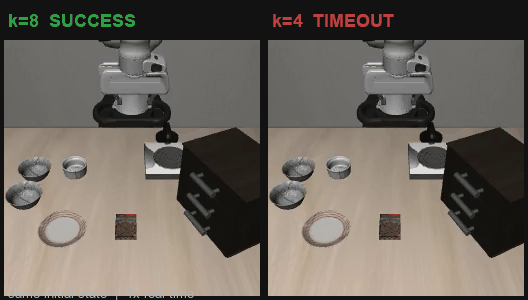

# OpenVLA-OFT + LIBERO-Spatial：语言条件机械臂仿真控制与评测

这是一个**真实执行、可复现的小规模工程评测项目**，不是论文复现，也不是算法创新。

- 模型：官方权重 `moojink/openvla-7b-oft-finetuned-libero-spatial`
- 仿真：LIBERO `libero_spatial`，10 个语言条件任务
- 硬件：AutoDL 单卡 NVIDIA RTX 6000D 84GB（Blackwell，sm_120）
- 评测规模：基线 10 tasks × 10 episodes = 100 episodes；动作执行长度对照 k=1/4/8
- 训练：**没有训练**。只做官方权重推理、闭环控制和评测。
- 视频：真实 rollout 回放，30 fps，未加速；不是生成视频。

**结果一句话**：k=8 基线 99/100；k=4 同为 99/100，但模型调用约 2 倍；k=1 为 94/100，调用约 8.4 倍。单次推理延迟都在 124–126ms，主要成本来自调用次数。

## 演示视频

[](artifacts/demo_60s.mp4)

> 上方为 1× 实速 GIF 预览（左：k=8 成功；右：同一初始状态 k=4 超时）。
> 完整 62.7 秒演示视频：[`artifacts/demo_60s.mp4`](artifacts/demo_60s.mp4)。
> 视频只做剪辑、标题卡和文字说明，没有加速、补帧或生成式机器人画面。

> 官方代码来源与固定版本：
> - <https://github.com/moojink/openvla-oft> @ `e4287e94541f459edc4feabc4e181f537cd569a8`
> - <https://github.com/Lifelong-Robot-Learning/LIBERO> @ `8f1084e3132a39270c3a13ebe37270a43ece2a01`
>
> 本项目**没有修改**上述两个仓库的模型或仿真代码；新增的评测/分析代码都在本项目目录中。

配套文档：

- 环境记录：[`docs/ENVIRONMENT.md`](docs/ENVIRONMENT.md)
- 结果汇总（主表、逐任务、Wilson 区间、受控失败对照）：[`docs/RESULTS.md`](docs/RESULTS.md)
- 失败分析：[`docs/FAILURES.md`](docs/FAILURES.md)
- 简历描述：[`docs/RESUME.md`](docs/RESUME.md)
- 项目经历（简历版/展开版/30 秒口述）：[`docs/PROJECT_EXPERIENCE.md`](docs/PROJECT_EXPERIENCE.md)
- 面试材料（1 分钟 / 3 分钟 / 20+ 问答）：[`docs/INTERVIEW.md`](docs/INTERVIEW.md)

---

## 1. 项目做了什么

### 阶段 1：最小闭环

在 `libero_spatial` 的 task 0 上跑通：

```text
观察（agentview 256×256 + wrist 256×256 + proprio）
  → OpenVLA-OFT 预测 8 个动作
  → 执行动作
  → 重新观察
  → ...
```

保存完整 MP4、指令、配置、日志、模型加载/推理/仿真耗时和显存峰值。

### 阶段 2：基线

`libero_spatial` 全部 10 个任务，每项 10 个 episode，共 100 个 episode。
每个 episode 记录：

- 任务、任务 id、episode 编号
- 初始状态编号和 SHA-256 前 16 位
- 随机种子、环境种子
- 成功/失败、错误信息
- 环境步数、policy 步数、模型调用次数、生成动作数
- 模型推理时间（`torch.cuda.synchronize()` 前后计时）
- 仿真时间、视频保存时间、总墙钟时间
- 单次推理平均延迟、显存峰值
- 视频路径

### 阶段 3：动作执行长度对照

研究问题：

> 模型一次预测 8 个动作，每次执行其中多少步再重新观察，会怎样影响成功率和计算开销？

比较：

- `k=1`：只执行第 1 个动作，立即重新观察
- `k=4`：执行前 4 个动作，再重新观察
- `k=8`：执行完整 8 个动作，再重新观察（复用阶段 2 基线，不重复花钱）

**重要实现差异**：官方 `run_libero_eval.py` 用
`deque(maxlen=cfg.num_open_loop_steps)` 再 `extend(actions)`。当 k<8 时，
它保留的是动作块**最后 k 个**动作，而不是前 k 个。本项目的
`tools/run_eval.py` 明确改为“执行前 k 个，然后清空队列重新观察”，
以匹配实验问题。这个差异在面试中必须能解释。

---

## 2. 结果摘要

> 以下数字来自本项目真实运行，原始逐 episode 记录在 `results/`。
> 样本量为 10 tasks × 10 episodes；这不是论文的完整评测规模。

### 动作执行长度对照

<!-- RESULTS_TABLE_START -->
| 配置 | 执行长度 | episodes | 成功数 | 成功率 | 平均模型调用/ episode | 平均单次推理延迟 | 平均墙钟/ episode |
|---|---:|---:|---:|---:|---:|---:|---:|
| baseline | 8 | 100 | 99 | 99.0% | 13.32 | 126.28 ms | 7.93 s |
| k=1 | 1 | 100 | 94 | 94.0% | 111.76 | 124.45 ms | 20.28 s |
| k=4 | 4 | 100 | 99 | 99.0% | 26.51 | 125.92 ms | 9.51 s |
<!-- RESULTS_TABLE_END -->

### 逐任务成功率

| task | 任务指令（简写） | k=8 | k=1 | k=4 |
|---|---|---:|---:|---:|
| 0 | bowl between plate and ramekin → plate | 10/10 | 10/10 | 10/10 |
| 1 | bowl next to ramekin → plate | 10/10 | 9/10 | 10/10 |
| 2 | bowl from table center → plate | 10/10 | 9/10 | 10/10 |
| 3 | bowl on cookie box → plate | 10/10 | 10/10 | 10/10 |
| 4 | bowl in top drawer → plate | 10/10 | 10/10 | 10/10 |
| 5 | bowl on ramekin → plate | 10/10 | 9/10 | 10/10 |
| 6 | bowl next to cookie box → plate | 10/10 | 10/10 | 10/10 |
| 7 | bowl on stove → plate | 10/10 | 9/10 | 10/10 |
| 8 | bowl next to plate → plate | 10/10 | 9/10 | 9/10 |
| 9 | bowl on wooden cabinet → plate | 9/10 | 9/10 | 10/10 |
| **总计** | | **99/100** | **94/100** | **99/100** |

完整主表、计算开销、Wilson 区间和受控失败对照见 [`docs/RESULTS.md`](docs/RESULTS.md)。

### 关键观察

- `k=8` 基线在 Spatial 上已经很强：99/100，只有一个超时失败。
- `k=4` 与基线同为 99/100，但平均模型调用从 13.32 增到 26.51 次/episode
  （约 2.0 倍），平均墙钟从 7.93s 增到 9.51s（约 +20%）。
- `k=1` 为 94/100：6 个失败 episode **全部**跑到 220 个 policy steps 上限；
  k=1 每步调用一次模型，所以模型调用也是 220 次。平均模型调用增到 111.76 次/episode，
  平均墙钟 20.28s。
- 三种配置的单次推理延迟都在 124–126ms，差别很小；主要成本来自
  “调用次数变多”，不是单次推理变慢。
- k=4 没有提高总体成功率，反而多花约一倍模型调用；k=1 在这组样本里低 5 个百分点，
  但 99/100 与 94/100 的 95% Wilson 区间有重叠（94.6–99.8% vs 87.5–97.2%），
  不能宣称显著差异，更不能外推到其他任务。
- 推理延迟用 `torch.cuda.synchronize()` 正确同步；总墙钟还包含仿真、视频保存和 Python 开销，不能把“墙钟”当成“GPU 推理时间”。

### 视频素材与剪辑说明

- `artifacts/demo_60s.mp4`：62.7 秒，1280×720，30 fps，1× 实速，无生成式机器人画面。
- 片段全部来自真实 rollout：基线成功、k=4/k=1 失败，以及同一初始状态下
  k=8 成功 / k=4 失败的对照。
- 原始完整视频在 `artifacts/phase2/`、`artifacts/phase3/`；演示视频只做剪辑、
  标题卡和文字说明，不做加速、不补帧。

---

## 3. 环境

### 硬件

| 项目 | 值 |
|---|---|
| 云平台 | AutoDL 容器实例 |
| GPU | NVIDIA RTX 6000D，85,651 MiB（约 84GB），compute capability 12.0 |
| 驱动 / CUDA | 595.71.05 / 13.2 |
| CPU / 内存 | 208 vCPU / 约 1.0 TiB |
| 数据盘 | `/dev/md0` 50GB（`/root/autodl-tmp`） |
| 系统 | Ubuntu 22.04.1 LTS |

### 软件

| 项目 | 版本 |
|---|---|
| Python | 3.10.22（独立 conda 环境） |
| PyTorch | 2.7.1+cu128 |
| torchvision / torchaudio | 0.22.1+cu128 / 2.7.1+cu128 |
| CUDA runtime | 12.8 |
| transformers | 4.40.1（`moojink/transformers-openvla-oft` fork） |
| TensorFlow | 2.15.0 |
| tensorflow_datasets | 4.9.3 |
| robosuite | 1.4.1 |
| MuJoCo | 2.3.7 |
| LIBERO | 8f1084e3132a39270c3a13ebe37270a43ece2a01 |
| openvla-oft | e4287e94541f459edc4feabc4e181f537cd569a8 |

### 与官方环境的差异

官方 `SETUP.md` 使用 PyTorch 2.2.0 + CUDA 12.1，官方论文环境是 A100。
这台机器是 Blackwell sm_120，PyTorch 2.2.0 没有对应内核，直接运行会报：

```text
NVIDIA RTX 6000D with CUDA capability sm_120 is not compatible with the current PyTorch installation.
```

因此本项目改用：

- `torch==2.7.1+cu128`、`torchvision==0.22.1+cu128`、`torchaudio==2.7.1+cu128`
- `pip install -e openvla-oft --no-deps`，避免官方 `pyproject.toml` 把 torch 降回 2.2.0
- 手动安装其余依赖；`transformers` fork 用 `--no-deps`，`dlimp` 正常安装
- `TORCH_FORCE_NO_WEIGHTS_ONLY_LOAD=1`，兼容 torch 2.7 的 `torch.load` 默认 `weights_only=True`

这属于**为硬件做的环境适配**，不是算法修改。与论文结果比较时要注意版本差异。

### 没有安装的东西

- **flash-attn**：官方 `SETUP.md` 注明它用于训练；推理路径不需要。跳过它节省了编译时间，也避免了一类常见编译失败。
- **LIBERO 训练数据集（约 10GB）**：只做推理，不下载。
- **没有微调**：没有 LoRA 训练，没有梯度更新。

---

## 4. 安装与下载

> 以下命令假设交付包已经解压到 `/root/autodl-tmp/project`，并且当前目录就是它。
> 从零开始可以：
>
> ```bash
> cd /root/autodl-tmp
> unzip openvla-libero-project.zip
> mv openvla-libero-project project
> cd project
> ```
>
> 如果 `project/` 已存在，先把已有内容备份，不要把旧结果覆盖掉。

### 4.1 只克隆两个仓库

```bash
mkdir -p /root/autodl-tmp/project
cd /root/autodl-tmp/project
source /etc/network_turbo

git clone https://github.com/moojink/openvla-oft.git
git -C openvla-oft checkout e4287e94541f459edc4feabc4e181f537cd569a8

git clone https://github.com/Lifelong-Robot-Learning/LIBERO.git
git -C LIBERO checkout 8f1084e3132a39270c3a13ebe37270a43ece2a01
```

不要克隆 LIBERO 数据集；不要 clone HuggingFace 权重仓库（用 `snapshot_download`）。

### 4.2 安装

普通 4090/3090（sm_89/sm_86）：

```bash
bash scripts/02_install.sh
```

Blackwell（sm_120，本项目实际使用）：

```bash
bash scripts/02_install_blackwell.sh
```

脚本做的事：

- apt 安装 EGL/GL/ffmpeg 等无显示器渲染依赖；
- 在 `/root/autodl-tmp/envs/openvla-oft` 建 Python 3.10 环境；
- 安装 PyTorch（按显卡分支）；
- 先跑 1024×1024 CUDA matmul 验证；
- editable 安装两个仓库；
- import 检查。

### 4.3 下载权重

```bash
bash scripts/03_model.sh
```

下载 `moojink/openvla-7b-oft-finetuned-libero-spatial` 到
`/root/autodl-tmp/hf_cache`，约 15GB。

---

## 5. 运行

### 5.1 阶段 1：单任务 smoke

```bash
bash scripts/04_smoke.sh
```

输出：

- `results/phase1/run/rollouts/.../*.mp4`
- `results/phase1/run/smoke.log`
- `results/phase1/run/gpu_monitor.csv`
- `results/phase1/run_manifest.json`
- `results/phase1_smoke_*.tar.gz`

### 5.2 阶段 2：基线

```bash
source /root/autodl-tmp/autodl_bundle/env.sh
cd "$PROJECT_ROOT"

python tools/run_eval.py \
  --task_suite_name libero_spatial \
  --task_ids all \
  --num_trials_per_task 10 \
  --num_open_loop_steps 8 \
  --seed 7 \
  --output_dir results/phase2/baseline \
  --run_id_note baseline-k8
```

### 5.3 阶段 3：执行长度对照

```bash
bash scripts/05_ablation.sh
```

它跑 k=1 和 k=4；k=8 复用阶段 2，不重复跑。

### 5.4 汇总

```bash
bash scripts/06_analyze.sh
```

输出：

- `results/analysis/all/comparison.csv`
- `results/analysis/all/per_task.csv`
- `results/analysis/all/failures.csv`
- `results/analysis/all/analysis.json`
- `results/analysis/all/success_by_task.png`
- `results/analysis/all/compute_by_k.png`

---

## 6. 代码来源与新增/修改

### 官方代码（未修改）

| 文件 | 用途 |
|---|---|
| `experiments/robot/libero/run_libero_eval.py` | 官方 LIBERO 评测主循环、`GenerateConfig`、模型初始化 |
| `experiments/robot/libero/libero_utils.py` | `get_libero_env`、`get_libero_dummy_action`、`save_rollout_video` |
| `experiments/robot/robot_utils.py` | `get_action`、`get_image_resize_size`、`set_seed_everywhere` |
| `prismatic/vla/constants.py` | LIBERO 的 `NUM_ACTIONS_CHUNK=8`、`ACTION_DIM=7`、`PROPRIO_DIM=8` |

### 项目新增

| 文件 | 说明 |
|---|---|
| `tools/run_eval.py` | 逐 episode 评测器；调用官方函数，新增 JSONL、初始状态哈希、模型调用计数、同步计时、视频路径、恢复运行 |
| `tools/run_single_task.py` | 阶段 1 单任务 runner |
| `tools/analyze_results.py` | 汇总/对比/失败清单/图表 |
| `scripts/*.sh` | 环境检查、克隆、安装、下载、smoke、对照、分析 |
| `env.sh` | 路径、固定 commit、EGL/PYTHONPATH/HF 缓存等环境变量 |

### `tools/run_eval.py` 与官方的具体差异

1. 只评测 `--task_ids` 指定的任务，而不是全部任务。
2. 每个 episode 写一行 JSONL；官方只写文本日志。
3. 记录 `model_calls`、`actions_generated`、`inference_seconds`、`sim_seconds`、`video_seconds`、`wall_seconds`。
4. 在 `get_action` 前后调用 `torch.cuda.synchronize()`，避免异步 CUDA 导致计时偏小。
5. 记录初始状态 SHA-256 前 16 位，便于核对“同一初始状态”。
6. 支持 `--resume`，中断后不重复跑已完成 episode。
7. 把官方 `deque(maxlen=k)` 的行为改为“执行前 k 个动作”，用于阶段 3。

---

## 7. 评测公平性与局限

- **相同模型**：三组配置都用同一个官方 checkpoint，没有换模型。
- **相同任务/初始状态**：`libero_spatial` 10 个任务，`initial_states[episode_idx]` 相同。
- **相同种子**：`seed=7`；环境种子在官方 `get_libero_env` 中固定。
- **相同预处理**：`env_img_res=256`、`center_crop=True`、双视角 + proprio，与官方评测一致。
- **只改执行长度**：k=1/4/8 是唯一有意变化的变量；视频保存、日志等外围开销相同。
- **样本量小**：每项任务 10 个 episode，总共 100 个；成功率有统计不确定性。
  本文给出 95% Wilson 区间（k=8/k=4: 94.6–99.8%，k=1: 87.5–97.2%），
  区间重叠，不能宣称显著差异，也不能当成论文复现。
- **单 GPU、单次运行**：没有多 seed 重复；不能估计 run-to-run 方差。
- **环境差异**：Blackwell + torch 2.7.1 与官方 A100 + torch 2.2.0 不同，绝对值不能直接与论文表格逐项对比。
- **视频**：`save_rollout_video` 以 30 fps 保存真实回放帧，未做加速或生成式补帧。

---

## 8. 失败分析

### 案例 1：基线 task 9 超时

- 任务：`pick up the black bowl on the wooden cabinet and place it on the plate`
- 配置：k=8，seed=7，episode_idx=2，初始状态 `6e3698ba2ffc6e03`
- 结果：失败；`env_steps=230`，`policy_steps=220`，`model_calls=28`
- 现象：跑到 220 个 policy steps 上限；结束时黑色碗仍在右侧木柜上，夹爪空着停在盘子上方。
- 视频：`artifacts/phase2/baseline/failure_task9_ep2.mp4`
- 帧：`artifacts/phase2/baseline/t9e2_1s.png`、`t9e2_3s.png`、`t9e2_end.png`
- **尚未验证的原因猜测**：可能是抓取阶段夹爪与碗的位置偏差，或抓取后物体滑落，随后策略继续执行“放置”动作；没有额外传感器/中间位姿日志，不能确认具体原因。

### 案例 2：k=1 的失败

- 任务：task 1，`pick up the black bowl next to the ramekin and place it on the plate`
- 配置：k=1，seed=7，episode_idx=7，初始状态 `a45364f84a9e141a`
- 结果：失败；`env_steps=230`，`policy_steps=220`，`model_calls=220`，
  `inference_s=27.028`，`wall_s=35.933`
- 现象：1s 目标碗在桌面右下方；3s 夹爪移动到左侧金属碗/炉台附近；
  5s 夹爪在盘子上方；结束帧目标碗仍在桌面，夹爪为空。episode 超时。
- 视频：`artifacts/phase3/k1/failure_task1_ep7.mp4`
- **尚未验证的原因猜测**：k=1 高频重规划可能造成犹豫/来回；也可能是初始定位
  偏到另一个碗，或抓取失败后继续执行放置。没有逐帧位姿日志，不能确认。
- 补充：k=1 的 6 个失败 episode 全部跑到 220 个 policy steps 上限（k=1 因而也是
  220 次模型调用），说明失败模式至少在高频调用/超时层面是一致的；但这仍不能证明
  “k=1 导致抓取失败”。

### 案例 3：k=4 与 k=8 在同一初始状态上的分歧

- 任务：task 8，`pick up the black bowl next to the plate and place it on the plate`
- 初始状态：`ad6e3d768b047e19`，seed=7，episode_idx=4
- 同一初始状态下：

| 配置 | 结果 | env steps | policy steps | model calls | inference | wall |
|---|---|---:|---:|---:|---:|---:|
| k=8 | 成功 | 102 | 92 | 12 | 1.502 s | 6.817 s |
| k=4 | 失败/超时 | 230 | 220 | 55 | 6.875 s | 15.761 s |
| k=1 | 失败/超时 | 230 | 220 | 220 | 28.392 s | 37.805 s |

- 现象：k=8 视频里完成抓取和放置；k=4 的结束帧里两个碗仍在左侧，夹爪空着
  停在盘子上方；k=1 同样超时。
- 视频：`artifacts/phase2/baseline/success_task8_ep4.mp4`、
  `artifacts/phase3/k4/failure_task8_ep4.mp4`、
  `artifacts/phase3/k1/failure_task8_ep4.mp4`
- **尚未验证的原因猜测**：缩短执行长度后，动作块边界和重新观察的时机改变了
  轨迹；可能在某一步没有对准抓取，随后继续执行“放置”动作直到超时。
  单个 episode 不能证明因果关系；没有腕部力/接触/物体位姿日志，不能确认。
- 价值：这是本项目最干净的受控对照，也是面试时最值得讲的失败案例；不要
  把它说成“k=4 必然失败”。

### 已知日志告警

- `EGL.eglMakeCurrent ... EGL_NOT_INITIALIZED`：出现在进程退出/解释器析构阶段；进程退出码为 0，成功标志和视频正常。**现象已观察，原因未完全验证**，不声称已修复。
- TensorFlow 在 sm_120 上提示 “not built with CUDA kernel binaries ... jit-compiled from PTX”：本项目推理不使用 TensorFlow 计算图；未观察到它对评测结果的影响，但保留为环境告警。

---

## 9. 复现检查清单

- [ ] `nvidia-smi` 显示 GPU、驱动、显存
- [ ] `git -C openvla-oft rev-parse HEAD` 等于固定 commit
- [ ] `git -C LIBERO rev-parse HEAD` 等于固定 commit
- [ ] `python -c "import torch; print(torch.__version__, torch.cuda.get_device_capability())"` 通过
- [ ] 权重目录含 `config.json`、`dataset_statistics.json`、`proprio_projector--150000_checkpoint.pt`、`action_head--150000_checkpoint.pt` 和权重 shard
- [ ] `bash scripts/04_smoke.sh` 退出码 0，生成非空 MP4
- [ ] `results/phase2/baseline/episodes.jsonl` 有 100 行
- [ ] `results/phase3/k1/episodes.jsonl` 有 100 行
- [ ] `results/phase3/k4/episodes.jsonl` 有 100 行
- [ ] `bash scripts/06_analyze.sh` 生成 `comparison.csv` 和图表
- [ ] 下载 `results/` 和视频后再释放实例

---

## 10. 项目文件结构

```text
.
├── README.md
├── env.sh
├── scripts/                 # 00_check ~ 06_analyze
├── tools/                   # run_eval.py / run_single_task.py / analyze_results.py
├── docs/                    # 环境、结果、失败、简历、面试
└── artifacts/
    ├── demo_60s.mp4         # 62.7s 演示，1× 实速
    ├── phase1/              # 阶段 1 视频/manifest/归档
    ├── phase2/baseline/     # 基线代表视频/失败帧/汇总
    ├── phase3/k1/           # k=1 代表失败视频/帧
    ├── phase3/k4/           # k=4 代表视频/失败帧
    ├── analysis/all/        # 三组对比 CSV/JSON/图表
    └── results/             # 完整原始 results 归档 tar.gz
```

`artifacts/results/openvla_libero_results.tar.gz` 是远端 `results/` 的完整归档
（含全部 `episodes.jsonl`、summary、日志和所有 rollout MP4）；解压后即可得到
README 中引用的 `results/...` 路径。`artifacts/` 下的视频是代表性副本，
完整录像以归档为准。

## 11. 费用与数据保留

- AutoDL 总预算上限 ¥500；阶段 1 上限 ¥100。
- 实际实例运行约 2 小时 45 分钟（2026-10-24 约 11:57–14:43，含安装、15GB 权重下载、
  smoke、300 个 episode 评测和失败视频抽帧）。RTX 6000D 的实时单价以 AutoDL
  控制台账单为准；本仓库不伪造精确金额。
- 本项目未训练模型，主要成本是 GPU 按量计费和 15GB 权重下载。
- 关机后 GPU 停止计费，但数据盘可能继续按天计费；释放实例会删除数据。
- 所有结果、视频、日志在释放实例前必须下载备份。本包已包含完整 `results` 归档。
